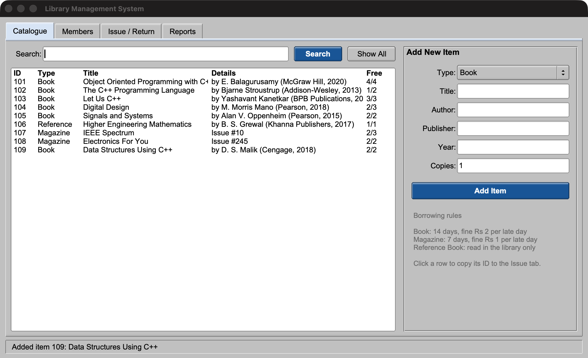
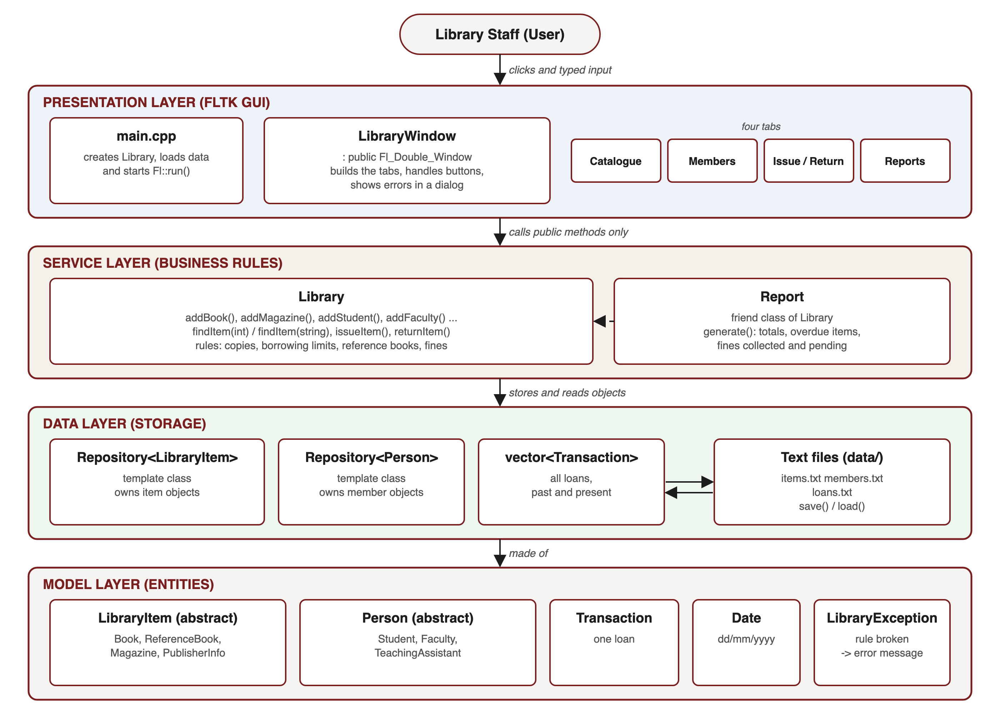
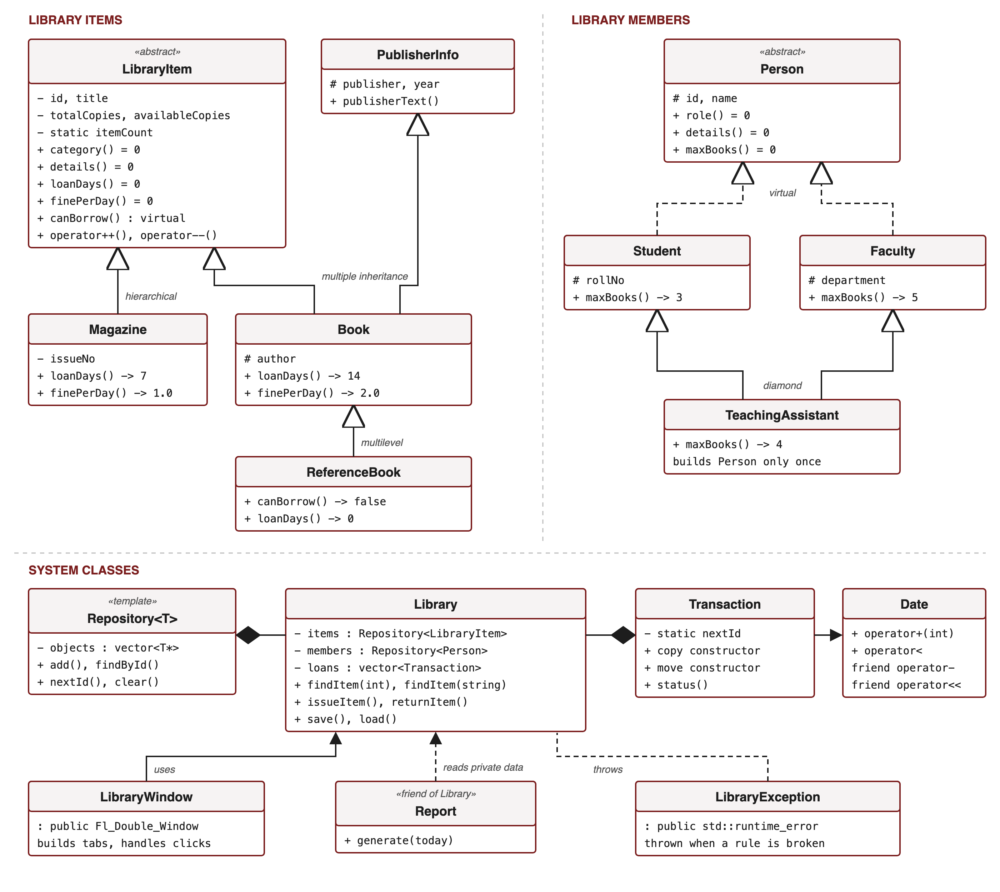
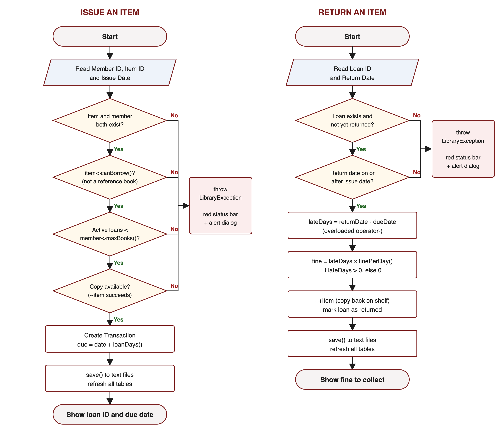
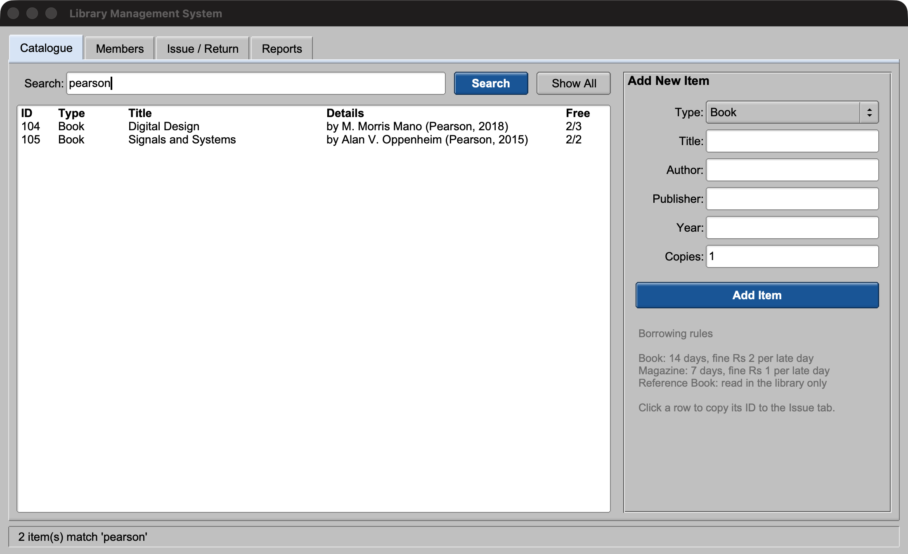
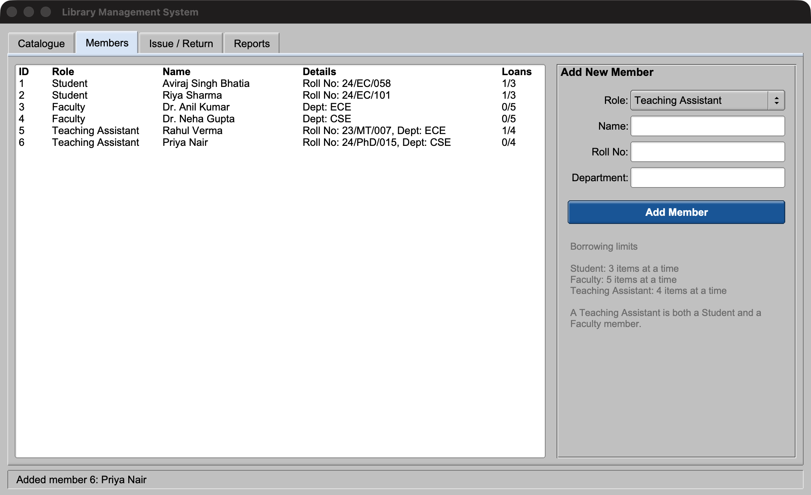
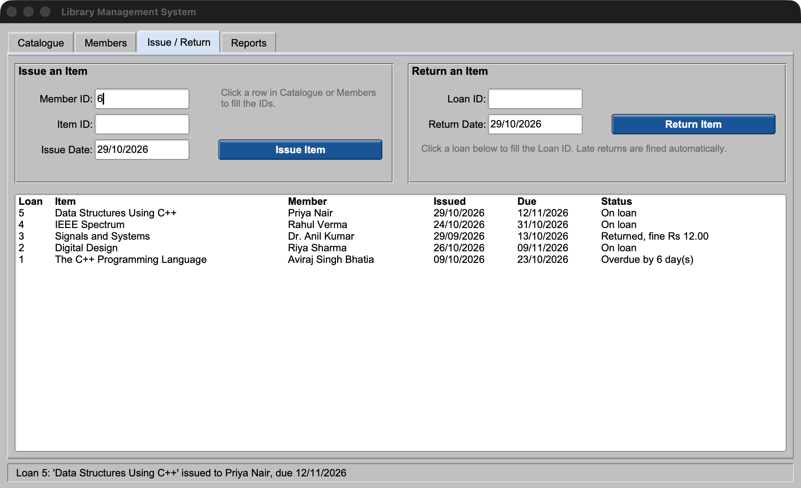
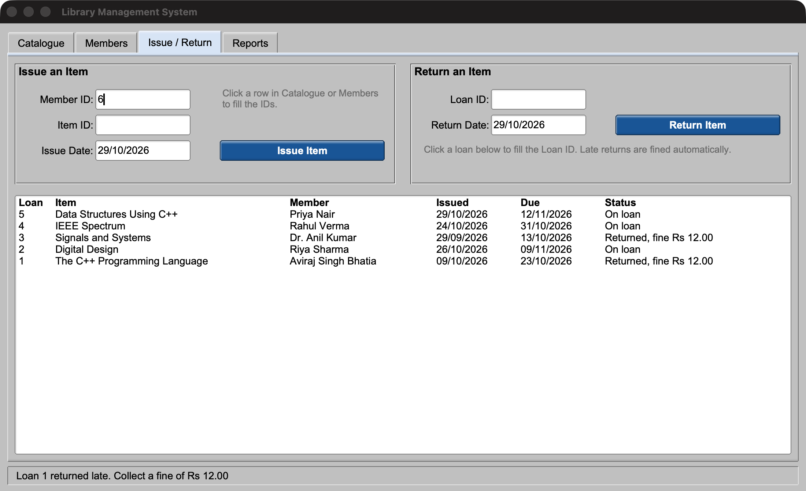
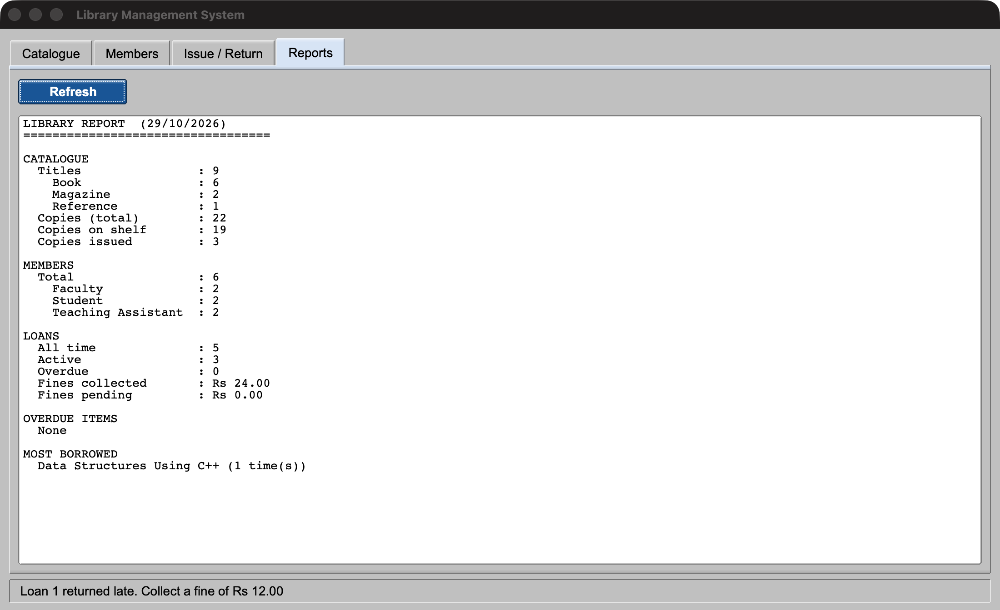
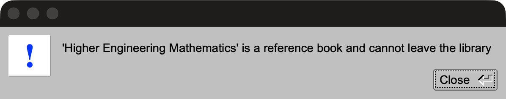

# Library Management System (C++ / FLTK)

A desktop application for running a small college library: keeping the
catalogue, registering members, issuing and returning books, and
charging fines for late returns. It is written in C++17 with an FLTK
graphical interface and is designed around the object-oriented
programming concepts covered in the OOP lab.



## Features

- **Catalogue**: add books, reference books and magazines, then search
  by title, author, publisher or issue number.
- **Members**: register Students, Faculty and Teaching Assistants. Each
  role has its own borrowing limit.
- **Issue / Return**: issue an item to a member, return it, and have
  the fine for a late return calculated automatically.
- **Reports**: see catalogue and member totals, active and overdue
  loans, fines collected and pending, and the most borrowed title.
- **Persistence**: everything is saved to plain text files in `data/`
  after every change and loaded again on start.
- **Validation**: every broken rule (no copies left, borrowing limit
  reached, invalid date and so on) raises an exception that the GUI
  shows as an error dialog.

| Item type      | Loan period | Fine per late day |
|----------------|-------------|-------------------|
| Book           | 14 days     | Rs 2              |
| Magazine       | 7 days      | Rs 1              |
| Reference Book | in-library only | n/a           |

| Member role        | Items at a time |
|--------------------|-----------------|
| Student            | 3               |
| Faculty            | 5               |
| Teaching Assistant | 4               |

## System Design

The code is split into four layers. Each layer only talks to the layer
directly below it.



| Layer        | Classes | Responsibility |
|--------------|---------|----------------|
| Presentation | `LibraryWindow`, `main.cpp` | FLTK window and tabs. Reads input, calls `Library`, shows results and errors. |
| Service      | `Library`, `Report` | Business rules (limits, copies, fines) and reporting. |
| Data         | `Repository<T>`, text files | Stores the objects in memory and saves them to and loads them from `data/*.txt`. |
| Model        | `LibraryItem` family, `Person` family, `Transaction`, `Date`, `LibraryException` | The entities of the system. |

### Class diagram



### Issue and return flow



## OOP Concepts Used

| Concept | Where it is used |
|---------|------------------|
| Classes and objects | Every entity is a class; `Library` creates and owns the objects |
| Encapsulation | Private data with getters in `LibraryItem`, `Transaction`, `Date` |
| Function overloading | `Library::findItem(int id)` and `Library::findItem(string text)` |
| Default and parameterized constructors | `Date()` (today) and `Date(d, m, y)` |
| Copy and move constructors | `Transaction(const Transaction&)` and `Transaction(Transaction&&)` |
| Binary operator overloading | `Date + int`, `Date - Date`, `==`, `<`, `<<` |
| Unary operator overloading | `--item` issues a copy and `++item` returns one (`LibraryItem`) |
| Static members | `LibraryItem::itemCount` / `getItemCount()`, `Transaction::nextId` |
| Friend functions | `operator-` and `operator<<` read the private fields of `Date` |
| Friend class | `Report` reads the private data of `Library` |
| Single inheritance | `Magazine : LibraryItem`, `LibraryWindow : Fl_Double_Window` |
| Multiple inheritance | `Book : LibraryItem, PublisherInfo` |
| Multilevel inheritance | `LibraryItem -> Book -> ReferenceBook` |
| Hierarchical inheritance | `Book` and `Magazine` from `LibraryItem`; `Student` and `Faculty` from `Person` |
| Virtual inheritance (diamond) | `Person -> Student, Faculty -> TeachingAssistant` |
| Abstract classes | `LibraryItem` and `Person` have pure virtual functions |
| Runtime polymorphism | `maxBooks()`, `finePerDay()`, `category()`, `details()` called through base pointers |
| Virtual destructors | `Repository<T>::clear()` deletes objects through base pointers |
| Templates | `Repository<T>` stores both items and members |
| Exception handling | `LibraryException` is thrown by the rules and caught in the GUI |
| File handling | `Library::save()` / `load()` use `ofstream` / `ifstream` |

## Project Structure

```
library-management-system/
├── include/              header files (class declarations)
│   ├── Date.h
│   ├── LibraryException.h
│   ├── LibraryItem.h     LibraryItem, PublisherInfo, Book,
│   │                     ReferenceBook, Magazine
│   ├── Member.h          Person, Student, Faculty,
│   │                     TeachingAssistant
│   ├── Transaction.h
│   ├── Repository.h      template, header only
│   ├── Library.h
│   ├── Report.h
│   └── LibraryWindow.h
├── src/                  implementations
│   ├── Date.cpp  LibraryItem.cpp  Member.cpp  Transaction.cpp
│   ├── Library.cpp  Report.cpp  LibraryWindow.cpp
│   └── main.cpp
├── tests/test_library.cpp   console tests (no GUI)
├── docs/                 diagrams and screenshots
└── Makefile
```

## Building and Running

You need a C++17 compiler and FLTK 1.3 or newer.

```bash
# macOS
brew install fltk

# Ubuntu / Debian
sudo apt install g++ make libfltk1.3-dev

make          # builds build/library
make run      # starts the app
make test     # builds and runs the console tests
make clean
```

On the first run the app creates `data/` and fills it with sample books,
members and loans, so every screen has something to show. Delete the
`data/` folder to start again from the sample data.

## Screenshots

| | |
|---|---|
|  |  |
|  |  |
|  |  |

## Data Files

Each record is one line, with fields separated by `|`:

```
items.txt    BOOK|101|Digital Design|M. Morris Mano|Pearson|2018|3|2
             MAGAZINE|107|IEEE Spectrum|10|3|2
members.txt  STUDENT|1|Riya Sharma|24/EC/101
             TA|5|Rahul Verma|23/MT/007|ECE
loans.txt    1|102|1|The C++ Programming Language|Aviraj Singh Bhatia|09/10/2026|23/10/2026|0|09/10/2026|0
```
